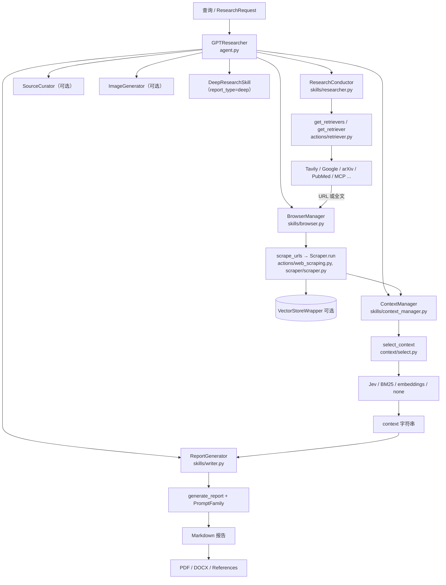

# 架构：抓取器、检索器、主智能体与多智能体

所有符号均来自本仓库源码；`路径:行号` 为定位锚点。

## 1. 总体组件图



## 2. 主智能体 `GPTResearcher`

### 2.1 构造阶段（`gpt_researcher/agent.py:58-218`）

`GPTResearcher.__init__()` 负责配置与组件装配：

- `Config(config_path)` + `set_verbose()`；`max_subtopics` 参数会覆盖 config 值（:152-161），因为 `construct_subtopics()` 从 `cfg.max_subtopics` 读取。
- 核心状态：`query`, `report_type`, `report_source`, `report_format`, `tone`, `source_urls`, `document_urls`, `query_domains`, `visited_urls`, `context`, `research_costs`, `step_costs`, `research_sources`, `research_images`。
- `vector_store` 被 `VectorStoreWrapper` 包裹；`_memory` **延迟构建**，因为 Jev/keyword 路径不需要 embedding 模型（:193-196, `memory` property :300-306）。
- `retrievers = get_retrievers(headers, cfg)`（:193）。
- 组件：`ResearchConductor`, `ReportGenerator`, `ContextManager`, `BrowserManager`, `SourceCurator`；`DeepResearchSkill` 仅在 `report_type == "deep"` 时创建（:202-210）；`ImageGenerator` 总是实例化但由配置决定是否启用（:212-215）。
- MCP 策略由 `_resolve_mcp_strategy()` 统一解析（:234-298）：优先显式 `mcp_strategy` → 兼容旧 `mcp_max_iterations` → 配置 → `fast`。
- 观测事件通过 `emit_research_event()`（:360-362）转发到可选的 `ResearchObserver`。

### 2.2 生命周期方法

| 方法 | 位置 | 作用 |
|---|---|---|
| `conduct_research(on_progress=None)` | `gpt_researcher/agent.py:364-434` | deep 模式转 `_handle_deep_research()`；否则 `choose_agent()` 生成 `(agent, role)`，调用 `ResearchConductor.conduct_research()` 得到 context，再预生成图像 |
| `_handle_deep_research()` | :436-482 | 调 `DeepResearchSkill.run()`，记录 breadth/depth/concurrency、成本与事件 |
| `write_report(...)` | :484-525 | 调 `ReportGenerator.write_report()`，传入 `available_images`，记录报告长度与图像数 |
| `write_introduction()` / `write_report_conclusion()` | :541-550, :527-539 | 分别委托 `ReportGenerator` 的对应方法 |
| `quick_search(query, query_domains, aggregated_summary, all_retrievers)` | :552-603 | 跳过完整流程；`all_retrievers=True` 时并发查询并用 URL 去重 |
| `_search_all_retrievers()` | :605-639 | `asyncio.gather(..., return_exceptions=True)`，坏 provider 不中断整体 |
| `get_subtopics()` / `get_draft_section_titles()` | :641-658 | 委托 `ReportGenerator` |
| `add_references()` / `extract_headers()` / `extract_sections()` / `table_of_contents()` | :721-764 | 委托 `actions/markdown_processing.py` |
| `get_costs()` / `get_step_costs()` / `add_costs()` | :782-833 | 成本按 `_current_step` 分桶；`_PENDING_LOG_TASKS` 防止 fire-and-forget 任务被 GC |

## 3. 检索器子系统

### 3.1 工厂

`gpt_researcher/actions/retriever.py`：

- `get_retriever(name)`（:16-137）内置映射：`google, searx, searchapi, serpapi, serper, duckduckgo, bing, brave, bocha, arxiv, tavily, groundroute, exa, crw, semantic_scholar, pubmed_central, custom, mcp, xquik, openalex, getxapi`；未知名字通过 `_load_plugin_retriever()`（:140-148）从 entry-point 组 `gpt_researcher.retrievers` 加载，**内置名优先**。
- `get_retrievers(headers, cfg)`（:151-194）优先级：headers `retrievers`/`retriever` → cfg `retrievers`/`retriever` → 默认 `TavilySearch`。逗号分隔值会 strip；无效名回退默认。
- `get_default_retriever()`（:197-204）返回 `TavilySearch`。

`get_all_retriever_names()`（`retrievers/utils.py:86-107`）扫描 `retrievers/` 子目录并合并插件名；`VALID_RETRIEVERS`（:62-84）为异常时的 fallback 列表。

### 3.2 结果契约：`BaseRetriever.requires_scraping`

`gpt_researcher/retrievers/base.py:35-61`：

- `requires_scraping: bool = True`（默认）：结果含 `url`/`href`，`body`/`snippet` 只当预览，后续必须抓取；
- `requires_scraping = False`：结果已含 `raw_content`，不再抓取。

显式覆盖的检索器：`CustomRetriever`, `PubMedCentralSearch` 为 False；`Duckduckgo`, `SearxSearch`, `TavilySearch` 为 True（grep 验证）。未声明的第三方检索器沿用旧的 `len(raw_content) > 100` 启发式（`skills/researcher.py:926-994`）。这个标记解决的是“长 snippet 被误当全文 → citation 丢失”的问题（gpt_researcher/retrievers/base.py:11-29）。

### 3.3 检索与抓取的分工

- `actions/query_processing.py:get_search_results()`（:44-81）：实例化检索器（MCP 分支额外传 `researcher`），用 `asyncio.to_thread()` 调同步 `search()`，避免阻塞事件循环。
- `ResearchConductor._search_relevant_source_urls()`（skills/researcher.py:890-1024）：遍历所有非 MCP 检索器，按 `requires_scraping` 分流为 `new_search_urls` 或 `prefetched_content`；去重、随机化顺序，并发出 `candidate_discovered`/`selected_for_fetch`/`candidate_deduplicated` 等事件。
- `ResearchConductor._scrape_data_by_urls()`（:1026-1063）：调用 `BrowserManager.browse_urls()`，再合并 prefetched 内容，必要时灌入 vector store。

### 3.4 MCP 检索器（两阶段）

`gpt_researcher/retrievers/mcp/retriever.py:27-...` 的 `MCPRetriever`：

1. 收集所有工具 → `MCPToolSelector.select_relevant_tools(query, all_tools, max_tools=3)`；
2. `MCPResearchSkill` 用选定工具执行研究，由 `MCPStreamer` 输出日志。

协作组件：`gpt_researcher/mcp/client.py:MCPClientManager`, `mcp/tool_selector.py:MCPToolSelector`, `mcp/research.py:MCPResearchSkill`, `mcp/streaming.py:MCPStreamer`。

策略（`ResearchConductor._get_mcp_strategy()`, skills/researcher.py:441-465）：

| 策略 | 行为 |
|---|---|
| `fast`（默认） | 只用原始 query 跑一次 MCP，结果缓存 `_mcp_results_cache`，所有 sub-query 复用（:362-376, :598-610） |
| `deep` | 每个 sub-query 都跑 MCP（:611-622） |
| `disabled` | 完全跳过（:352-361） |

`_execute_mcp_research()`（:696-776）用 `asyncio.to_thread(retriever_instance.search, ...)`，因为 MCP 的同步 `search()` 会占用调用线程最长 300s。`_tavily_mcp_redundant_with_direct()`（:523-548）在已有直接 Tavily retriever 且 MCP 配置全是 Tavily 时跳过 MCP，避免双倍计费。

## 4. 抓取器子系统

### 4.1 调用链

```text
BrowserManager.browse_urls(urls)                skills/browser.py:37-87
  → scrape_urls(urls, cfg, worker_pool, ...)    actions/web_scraping.py:12-57
    → Scraper(urls, user_agent, scraper, ...)   scraper/scraper.py:121-156
      → Scraper.run()                           :158-194
        → extract_data_from_url()               :230-313
          → validate_url()（SSRF 防护）          utils/url_security.py
          → get_scraper(link)                   scraper/scraper.py:366-415
          → scraper.scrape_async() 或线程池 scrape()
```

`BrowserManager.__init__()` 用 `cfg.max_scraper_workers` 和 `cfg.scraper_rate_limit_delay` 建 `WorkerPool`（skills/browser.py:32-35）。`WorkerPool.throttle()`（utils/workers.py:35-50）用**本池 semaphore + 全局单例 rate limiter** 双重限流，因此 deep research 的多个 researcher 共享全局速率上限。

`scrape_urls()` 返回 `(scraped_data, images)`；`BrowserManager.browse_urls()` 把 scraped_data 加入 `researcher.research_sources`，用 `select_top_images(..., k=4)` 做内容哈希去重后加入 `research_images`（skills/browser.py:61-63, :89-118）。

### 4.2 Scraper 路由与质量过滤

`Scraper.get_scraper()`（`scraper/scraper.py:366-415`）映射表：

| key | 类 |
|---|---|
| `pdf` | `PDFScraper` |
| `arxiv` | `ArxivScraper` |
| `bs`（默认） | `BeautifulSoupScraper` |
| `web_base_loader` | `WebBaseLoaderScraper` |
| `browser` | `BrowserScraper` |
| `nodriver` | `NoDriverScraper` |
| `tavily_extract` | `TavilyExtract` |
| `firecrawl` | `FireCrawl` |

路由规则：检查 URL **path** 是否以 `.pdf` 结尾（大小写不敏感，忽略 query 签名），或主机为 `arxiv.org`/`*.arxiv.org`；否则使用配置的 `SCRAPER`（:397-411）。

`extract_data_from_url()` 的质量门槛（:230-313）：

- 先 `validate_url()`，拒绝内网/回环/云元数据/`file://` 等（:236-247）；
- 内容 < 100 字符 → `_reject()`；
- `_looks_like_block_page()`（反爬挑战页）、`_looks_like_word_list()`（词表）→ `_reject()`；
- 文本像未解析 PDF 且当前不是 `PDFScraper` → `_retry_as_pdf()`（:287-302, :333-364）；
- 成功返回 `{url, raw_content, image_urls, title}`；失败返回 `raw_content: None`，由 `Scraper.run()` 过滤掉（:189-194）。

## 5. 上下文与长文本重排

### 5.1 统一入口

`ContextManager.get_similar_content_by_query()`（skills/context_manager.py:38-64）调用 `select_context(query, pages, cfg, max_results=10, ...)`。`embeddings` 作为**零参数工厂**传入，只在 embeddings 模式才调用（`context/select.py:53-67`）。

### 5.2 过滤器选择

`resolve_context_filter(setting)`（`context/select.py:38-46`）：

| `CONTEXT_FILTER` | 行为 |
|---|---|
| `auto` | 有 `TYPESAFE_API_KEY` → `jev`，否则 `keyword` |
| `jev` | 用 Jev 打分；失败自动退化 keyword |
| `keyword` | 本地 BM25，无 API/key/embedding |
| `embeddings` | `ContextCompressor`；失败退化 keyword |
| `none` | 不过滤，全部传给 LLM |

小内容捷径：`total_chars < COMPRESSION_THRESHOLD`（默认 8000）且页面数 ≤ max_results 时直接 `pretty_print_docs()`（:74-77）。

### 5.3 三种重排实现

| 实现 | 位置 | 机制 |
|---|---|---|
| `JevContextCompressor` | `context/jev_filter.py:132-190` | `RecursiveCharacterTextSplitter(chunk_size=JEV_CHUNK_SIZE 默认 1000, overlap=size//10)`；`JevClient.score_relevance()` 按四级 usefulness rubric（:37-42）打分，429/529 指数退避重试（:90-125）；`JEV_MIN_SCORE` 默认 1.5；每 event loop 一个 `JEV_CONCURRENCY`（默认 64）信号量（:44-54） |
| `LexicalContextCompressor` | `context/lexical.py:69-107` | 同样切块；`bm25_scores()`（:48-66）按块内 IDF 计算；`relative_threshold` 默认由 `KEYWORD_RELATIVE_THRESHOLD=0.5` 注入，最多 `KEYWORD_MAX_RESULTS=25` 块；无关键词重叠时退回页面开头块 |
| `ContextCompressor` | `context/compression.py:88-191` | `RecursiveCharacterTextSplitter(1000, 100)` + `EmbeddingsFilter(similarity_threshold, 默认 SIMILARITY_THRESHOLD=0.35)` 组成 `DocumentCompressorPipeline`，外层 `ContextualCompressionRetriever`；成本经 `estimate_embedding_cost()` 回调 |

向量库路径：`VectorstoreCompressor`（`context/compression.py:36-85`）调 `VectorStoreWrapper.asimilarity_search()`；`VectorStoreWrapper.load()` 把 dict 转 LangChain Document（metadata.source = url），按 1000/200 切块后写入（vector_store/vector_store.py:17-60）。

`SearchAPIRetriever`（context/retriever.py:16-38）把 scrape dict 转成 Document，并把 `raw_content` 截断到 `MAX_CONTENT_CHARS`（默认 50000）以免超过 embedding API 限制。

已有章节去重：`get_similar_written_contents_by_draft_section_titles()`（skills/context_manager.py:89-130）对 `[current_subtopic] + draft_section_titles` 并发查询；embeddings 不可用时用 `rank_written_sections()`（context/lexical.py:110-133）做 BM25 退化。

## 6. 报告生成子系统

- `ReportGenerator.write_report()`（skills/writer.py:49-142）组装 `research_params`（query、role、report_type、report_source、tone、cfg、context、images、cost_callback），再调 `generate_report()`。**空 context 时直接返回弃答文本**（:79-88）。
- `actions/report_generation.py:209-327:generate_report()`：`get_prompt_by_report_type()` 选 prompt 函数；按 `subtopic_report`/`custom_prompt`/默认三种方式拼 content；若有预生成图片，追加 `AVAILABLE IMAGES` 的 Markdown 指令；用 `smart_llm` + `temperature=0.35` + streaming 生成；失败时重试一次 system 消息合并的调用。
- `PromptFamily`（prompts.py:14-...）集中所有模板：`generate_search_queries_prompt`（:213-259）、`generate_report_prompt`（:262-316，强制逐句 URL 引用）、`curate_sources`（:319-351）、`generate_resource_report_prompt`、`generate_outline_report_prompt`、`generate_custom_report_prompt`、`generate_deep_research_prompt`（:418-487）、`auto_agent_instructions`（:490-515）、`pretty_print_docs`（:555-...）、`generate_subtopics_prompt`、`generate_subtopic_report_prompt`、`generate_draft_titles_prompt`、`generate_report_introduction`、`generate_report_conclusion`。
- `get_prompt_by_report_type()`（:862-876）通过 `report_type_mapping`（:852-859）把 `ReportType` 值映射到方法名；无效类型发 warning 并回退 research_report。
- `get_prompt_family()`（:889-903）在 default 与 Granite 系列之间选择；Granite 家族覆写 `pretty_print_docs` / `join_local_web_documents`，注意它们对输入类型的约束。
- `SourceCurator.curate_sources()`（skills/curator.py:38-114）用 smart LLM 对 source_data 排序（temperature 0.2, max_tokens 8000）；解析失败返回原数据，不丢 context。

## 7. Deep Research（递归树）

`DeepResearchSkill`（skills/deep_research.py）：

- 配置来自 `cfg.deep_research_breadth/depth/concurrency`（:260-262）。
- `run()`（:597-670）：`generate_research_plan()` → 合成 combined_query → `deep_research()` → 给 learnings 附加 `[Source: url]` → 补原始 context → 裁剪到 `MAX_CONTEXT_WORDS = 25000`（:18）→ 写回 `researcher.context`。
- `deep_research()`（:396-595）：每轮 `generate_search_queries()` 产出 `{query, researchGoal}`；用 `asyncio.Semaphore(concurrency_limit)` 限制并发；每个分支创建一个普通 `research_report` 的 `GPTResearcher`（共享 visited_urls、MCP 配置），研究中 extracting learnings + citations + follow-up questions；深度 > 1 时 `breadth = max(2, breadth // 2)`, `depth -= 1` 递归。
- 防御：零查询结果或整层失败时停止下钻（:431-439, :513-531），避免无限工作。`ResearchProgress`（:246-254）用于 `on_progress` 回调。

## 8. 多智能体架构

### 8.1 LangGraph 团队（默认 multi_agents）

`multi_agents/agents/orchestrator.py:30-172:ChiefEditorAgent`：

- `_initialize_agents()`（:54-63）创建 `WriterAgent`, `EditorAgent`, `ResearchAgent`, `PublisherAgent`, `HumanAgent`, `FactCheckerAgent`, `VisualizerAgent`。
- `_create_workflow()`（:65-81）基于 `ResearchState`（`multi_agents/memory/research.py:5-23`，TypedDict）建立 `StateGraph`：节点 `browser → planner → researcher → writer → fact_checker → visualizer → publisher`，另有 `human` 节点。
- 边（:83-105）：`browser→planner→human`；human 条件边 `accept→researcher` / `revise→planner`；`researcher→writer→fact_checker`；fact_checker 条件边 `accept→visualizer` / `revise→writer`；`visualizer→publisher→END`。
- 两个有界循环：`route_human_feedback(task.max_plan_revisions)` 与 `route_fact_check(task.max_fact_check_revisions)`；超限抛错被 orchestrator 捕获并当作 accept，避免 LangGraph 递归限制导致整次运行失败（:107-135）。
- `run_research_task()`（:149-172）编译图并用 `thread_id/thread_ts` 配置 `ainvoke({"task": self.task})`。
- `multi_agents/agents/editor.py:EditorAgent` 自身还有一个并行研究子图（`_create_workflow()` :131-...），每个 query 一个 `ResearchAgent` 分支，经 `DraftReview` 回环修订。
- `multi_agents/main.py:69-89` 提供 `run_research_task(query, ...)` 与 CLI `main()`；`multi_agents/agent.py` 导出可编译的 `graph`（供 LangGraph Server 使用）。

### 8.2 AG2 团队

`multi_agents/ag2/agents/orchestrator.py:20-...` 是同名 `ChiefEditorAgent` 的 AG2 实现：`_llm_config()`, `_initialize_ag2_team()`, `_chat()`, `_initialize_agents()`；入口 `multi_agents/ag2/main.py:15-...`（`open_task`, `run_research_task`, `main`）。与 LangGraph 版本并列，不是同一份代码。

### 8.3 deep_agents（deepagents 框架）

`deep_agents/agent.py:63-89:build_agent()` 用 `create_deep_agent` 建 chief editor + `researcher` subagent，后端为 `FilesystemBackend(root_dir=run_dir, virtual_mode=True)`；工具由 `deep_agents/tools.py:9-78:build_research_tools()` 提供 `quick_search`（`GPTResearcher.quick_search`）与 `deep_research`（完整 conduct+write，带 `parent_query` 时选择 `subtopic_report`）。Chief editor 通过文件写 `sections/*.md` 并最终组装 `report.md`（`deep_agents/agent.py:11-60`）。

## 9. 服务与辅助子系统

- API：`backend/server/app.py` 定义 `ResearchRequest`（:53-61）与 `ChatRequest`（:64-68）；路由 `/report/`（:378-388）、`/api/reports*`、`/api/multi_agents`（:400-402）、`/files/`, `/upload/`, `/ws`（:415-426）、`/api/chat`。`write_report()`（:335-376）调 `run_agent()`，再导出 DOCX/PDF 并附带 `source_urls`, `research_costs`, `visited_urls`, `research_images`。
- `backend/server/websocket_manager.py:116-183:run_agent()` 按 report_type 选择 `multi_agents` / `DetailedReport` / `BasicReport`，并用 `CustomLogsHandler` 转发日志。
- `DetailedReport`（backend/report_type/detailed_report/detailed_report.py:10-206）：初始研究 → `get_subtopics()` → 并发 `_research_subtopic()`（每个子主题一个 `subtopic_report` researcher，共享 visited_urls）→ 顺序 `_write_subtopic_report()`（用已写章节做去重检索）→ TOC + conclusion + references 组装。
- LLM：`utils/llm.py:41-164:create_chat_completion()` 统一 provider 调用、temperature/reasoning_effort 适配、最多 10 次重试（streaming+websocket 时 1 次）、成本回调；`utils/llm.py:167-233:construct_subtopics()` 用 Pydantic parser 产出 Subtopics。
- 成本：`GPTResearcher.add_costs()` 按步骤累计（`gpt_researcher/agent.py:806-833`）；Jev 自己按 input token 计价（`jev_filter.py:127-129`）；`estimate_embedding_cost()` 用于 embeddings 路径。
- 安全：`utils/url_security.py` 提供 `validate_url()`/`UnsafeURLError`；抓取器在请求前调用。
- 观测：`observability.py:ResearchObserver`（Protocol）与 `emit_research_event()`；事件包括 `query_planned`, `candidate_discovered`, `content_prefetched`, `fetch_succeeded/failed`, `search_failed`, `search_empty` 等。

## 10. 扩展接缝与注意事项

| 想做的事 | 正确接缝 | 不要做 |
|---|---|---|
| 新增 web 检索器 | 在 `retrievers/` 建目录 + 类，声明 `requires_scraping`，在 `get_retriever()` 注册；或用 entry point `gpt_researcher.retrievers` | 直接改 `ResearchConductor` 的硬编码分支 |
| 新增抓取后端 | 实现 `scrape_async()` 或 `scrape()`，在 `Scraper.get_scraper()` 的 `SCRAPER_CLASSES` 注册「返回 (content, image_urls, title)」 | 返回自定义 dict 破坏 run() 契约 |
| 新增上下文过滤器 | 实现 `async_get_context(query, max_results, cost_callback)`，在 `context/select.py` 增加 mode | 在 `ContextManager` 里写死 provider 逻辑 |
| 新增报告类型 | `ReportType` 枚举 + `report_type_mapping` + `PromptFamily` 方法；若是多节报告，检查 `run_agent()`/`cli.py` 分支 | 只改一处入口 |
| 新增 MCP 工具源 | 通过 `mcp_configs` 传入，不改 `os.environ` | 在请求处理里写进程级环境变量（见 #1676） |
| 调试抓取丢失引用 | 检查 `requires_scraping`、`visited_urls`、Scraper 质量过滤与 `fetch_failed` 事件 | 直接调大 `raw_content` 长度阈值 |
