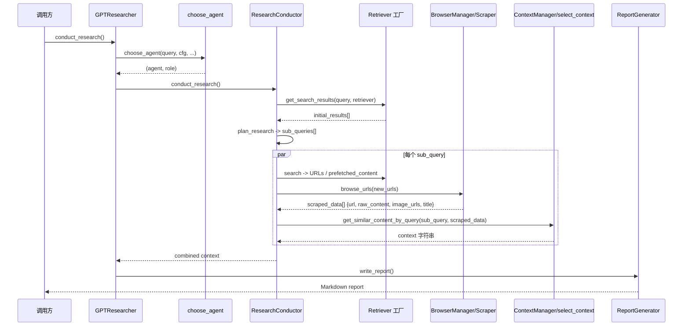

# 阶段流程与数据流：从查询规划到报告生成

本文按**实际调用顺序**描述单研究者（basic）、详细报告（detailed）、深度研究（deep）与多智能体四条路径，并给出每步的数据形状。符号锚点均为本仓库源码。

## 1. 基本流程时序



## 2. 阶段 0：配置与 agent 选择

1. `GPTResearcher.__init__()`（`gpt_researcher/agent.py:58-218`）加载 `Config`、解析 retrievers、装配 skills。
2. `conduct_research()`（:364-434）若没有 `(agent, role)`，调用 `choose_agent()`（`actions/agent_creator.py:18-71`）：
   - 用 `cfg.smart_llm_model`、`auto_agent_instructions()` 生成 `{server, agent_role_prompt}`；
   - `json_repair.loads` 优先，失败走 `handle_json_error()`（:74-119：json_repair → 正则提取 → 默认 agent）；
   - 温度 0.15。
3. 日志事件：`start` → `choose_agent` → `agent_selected` → `conducting_research`（gpt_researcher/agent.py:376-412）。

## 3. 阶段 1：查询规划（planning）

`ResearchConductor.conduct_research()`（skills/researcher.py:121-274）按 `report_source` 分流：

| `report_source` | 数据获取路径 |
|---|---|
| `source_urls` 非空 | `_get_context_by_urls()`；若 `complement_source_urls` 则再拼接 web 搜索（:169-186） |
| `web`（默认） | `_get_context_by_web_search(query, [], query_domains)`（:187-189） |
| `local` | `DocumentLoader(cfg.doc_path).load()` → 可选灌入 vector store → `_get_context_by_web_search(query, document_data, ...)`（:190-197） |
| `hybrid` | `OnlineDocumentLoader(document_urls)` 或 `DocumentLoader`；本地/网络两路 `asyncio.gather` 并发，用 `prompt_family.join_local_web_documents()` 合并（:199-219） |
| `azure` | `AzureDocumentLoader` → `DocumentLoader` → web 搜索（:220-228） |
| `langchain_documents` | `LangChainDocumentLoader(researcher.documents)`（:230-238） |
| `langchain_vectorstore` | `_get_context_by_vectorstore(query, vector_store_filter)`（:239-240） |

`_get_context_by_web_search()`（:329-439）：

1. 若配置了 MCP retriever，按策略先执行 MCP（:342-393，详见架构文档 §3.4）；
2. `initial_results = await _get_initial_search_results(query, query_domains)`（:396；该方法用**第一个 retriever** 和 `cfg.max_search_results_per_query`，:59-84）；
3. `sub_queries = await plan_research(query, query_domains, search_results=initial_results)`（:397）；
4. 非 `subtopic_report` 时把原始 query 追加进 sub_queries（:400-402）；
5. `asyncio.gather` 并发 `_process_sub_query()`，并拼接 `initial_context`（由初始结果真实抓取而来，不把 snippet 当页面，:875-888）与所有结果（:414-436）。

规划核心 `plan_research_outline()`（`actions/query_processing.py:158-215`）：

- 若只有 MCP retriever，直接返回 `[query]`，不再生成子查询（:191-199）；
- 否则 `generate_sub_queries()`（:83-156）用 `cfg.strategic_llm_model` + `ReasoningEfforts.Medium` 生成，失败时降级到 `smart_llm`；输出经 `_normalize_sub_queries()`（:12-40）归一为 `list[str]`，兼容 `["q"]`, `{"queries": [...]}`, 纯字符串等形状。

Prompt 约束（`prompts.py:213-259`）：默认生成 `cfg.max_iterations`（默认 3）条自然语言查询，禁止 `site:`、`filetype:`、`OR`/`AND` 等搜索运算符，因为并非所有后端支持。

## 4. 阶段 2：多源检索与抓取

### 4.1 每个 sub-query

`_process_sub_query()`（skills/researcher.py:551-694）：

1. 分离 MCP / 非 MCP retrievers；若 `_tavily_mcp_redundant_with_direct()` 为真则清空 MCP（:568-584）；
2. 按 MCP 策略取缓存 / 逐 query 执行（:590-634）；
3. 无外部 scraped_data 时调用 `_scrape_data_by_urls()`（:637-639）；
4. 用 `ContextManager.get_similar_content_by_query()` 得到 `web_context`（:641-644）；
5. `_combine_mcp_and_web_context()`（:778-829）先放 web 文本，再放格式化 MCP 条目（`*Source: title (url)*`），失败返回空串而不是抛错。

### 4.2 URL 发现与去重

`_search_relevant_source_urls()`（:890-1024）数据形状：

- 输入：`query`, `query_domains`, 可选 `initial_results`（复用规划阶段结果，避免第二次搜索）；
- 每个 retriever 实例化并 `asyncio.to_thread(retriever.search, max_results=cfg.max_search_results_per_query)`；
- 结果项字段：`href|url`（必需）、`raw_content`（可选）、`body/snippet`（预览）；
- 分流：
  - `requires_scraping is True` → `new_search_urls`；
  - `requires_scraping is False` 且有 `raw_content` → `prefetched_content.append({"url":..., "raw_content":...})`，并把 URL 加入 `visited_urls`（:955-965）；
  - 未声明的 retriever 用 `len(raw_content) > 100` 旧规则（:976-992）；
- `_get_new_urls()`（:852-873）按 `visited_urls` 去重并写回；最终的 `new_search_urls` 会 `random.shuffle()`（:1022）。

事件：`search_empty`, `candidate_discovered`（带 rank）, `content_prefetched`, `search_failed`, `selected_for_fetch`, `candidate_deduplicated(ALREADY_VISITED)`。

### 4.3 抓取

`_scrape_data_by_urls()`（:1026-1063）→ `BrowserManager.browse_urls()` → `scrape_urls()` → `Scraper.run()`，细节见架构文档 §4。输出是 `list[dict]`：

```json
{"url": "https://...", "raw_content": "页面正文", "image_urls": [...], "title": "..."}
```

失败项为 `raw_content: null`，在 `Scraper.run()` 中被过滤（`scraper/scraper.py:189-194`）。成功后：`research_sources` 累积，`vector_store.load()` 切块入库，`research_images` 经内容哈希去重保留 top 4。

## 5. 阶段 3：长文本重排与上下文压缩

`ContextManager.get_similar_content_by_query()`（skills/context_manager.py:38-64）→ `select_context()`（`context/select.py:53-101`）：

```text
pages[]  ──SearchAPIRetriever──►  Document(page_content=raw_content[:50000],
                                          metadata={title, source=url})
       ──RecursiveCharacterTextSplitter──►  chunks[]
       ──mode: jev | keyword | embeddings | none──►  selected[]
       ──PromptFamily.pretty_print_docs()──►  context 字符串
```

关键参数与退化行为：

| mode | 选择逻辑 | 失败/回退 |
|---|---|---|
| `auto` | 有 `TYPESAFE_API_KEY` → jev，否则 keyword | — |
| `jev` | 每块四级 usefulness 打分，`>= JEV_MIN_SCORE(1.5)` 取前 N | `JevError` → keyword |
| `keyword` | BM25，保留分数 ≥ `KEYWORD_RELATIVE_THRESHOLD(0.5) × best`，最多 `KEYWORD_MAX_RESULTS(25)` | 无重叠时取开头块 |
| `embeddings` | `EmbeddingsFilter(similarity_threshold 默认 0.35)` | 任意异常 → keyword |
| `none` | 全量输出 | — |

短文本捷径：`total_chars < COMPRESSION_THRESHOLD(8000)` 且页数 ≤ `max_results` 时跳过打分直接格式化（`select.py:74-77`）。这样小结果集不会产生 embedding/Jev 成本。

可选的 `SourceCurator.curate_sources()`（`ResearchConductor.conduct_research()` :242-260，需 `cfg.curate_sources = True`）会再按可信度排序；返回 `List[dict]` 时被规范化为 `Title/Content/Source` 文本，避免下游 `"\n".join` 因 dict 崩溃。

## 6. 阶段 4：大纲与（可选）详细报告子树

### 6.1 简单报告

`GPTResearcher.write_report()` → `ReportGenerator.write_report()` → `generate_report()` → `PromptFamily.generate_report_prompt()` → smart LLM → Markdown。Prompt 明确要求（prompts.py:301-315）：

- Markdown headers（#/##/###）、表格；
- 每条实质 claim/figure/quote 带行内超链接引用；
- Web 来源在结尾列 references 且去重；
- 不写 TOC；至少 `cfg.total_words` 字。

### 6.2 详细报告（`DetailedReport`）

`backend/report_type/detailed_report/detailed_report.py:83-90:run()`：

1. `_initial_research()`：主 researcher 跑完整流程，保存 `global_urls`；
2. `_get_all_subtopics()`：`construct_subtopics()`（Pydantic `Subtopics`）产出 task 列表；
3. `write_introduction()`；
4. `_generate_subtopic_reports()`：
   - 对所有子主题**并发** `_research_subtopic()`（每个新建 `GPTResearcher(report_type="subtopic_report")`，共享 agent/role/visited_urls/MCP 配置，:129-171）；
   - 每个子主题生成 draft section titles，用 `extract_headers()` 解析；
   - **顺序** `_write_subtopic_report()`：用 `get_similar_written_contents_by_draft_section_titles()` 避免与已写章节重复，写完后把 sections/urls 并入全局（:173-196）；
5. `_construct_detailed_report()`：TOC + body + conclusion + `add_references()`（:198-206）。

`add_references()`（`actions/markdown_processing.py:105-131`）按 URL **排序**后追加 `## References`，保证同输入下输出确定性。

### 6.3 深度报告（`report_type="deep"`）

见架构文档 §7。`DeepResearchSkill.run()` 得到的 context 是 learnings（带 `[Source: url]`）+ 原始 context，最终仍由 `GPTResearcher.write_report()` 使用 `generate_deep_research_prompt()`（prompts.py:418-487）生成报告，`generate_report()` 的 prompt 路由见 `report_type_mapping`（prompts.py:852-859）。

### 6.4 多智能体

`ChiefEditorAgent.run_research_task()` 编译 LangGraph（`browser→planner→human→researcher→writer→fact_checker→visualizer→publisher→END`）；`ResearchState`（multi_agents/memory/research.py:5-23）承载 `initial_research`, `research_data`, `sections`, `human_feedback`, `plan_revision_count`, `title/headers/table_of_contents/introduction/conclusion/sources/report/fact_check_notes/diagrams/fact_check_revision_count`。两个有界反馈环见架构文档 §8.1。

## 7. 阶段 5：导出与响应

- CLI（`cli.py:270-364`）：生成 LLM 标题 → 安全文件名 → YAML frontmatter（`_build_frontmatter()`, :210-247）→ `outputs/<stem>.md` → 可选 `write_md_to_pdf()` / `write_md_to_word()`（`--no-pdf`, `--no-docx` 可关）。
- API：`write_report()`（backend/server/app.py:335-376）把 Markdown 转 DOCX/PDF，并返回 `research_id`, `report`, `docx_path`, `pdf_path` 以及 `research_information`（source_urls / costs / visited_urls / images）。`POST /report/` 支持 `generate_in_background`（:378-388）。

## 8. 数据流总表

| 阶段 | 输入 | 输出数据形状 | 主要代码 |
|---|---|---|---|
| 配置 | env / config_path / headers | `Config` 属性（`retrievers` 为类列表） | `config/config.py:36-75` |
| Agent 选择 | query + cfg | `(agent_name, role_prompt)` | `actions/agent_creator.py:18-71` |
| 初始搜索 | query + 首 retriever | `list[{title, href/url, body/snippet, raw_content?}]` | `query_processing.py:44-81` |
| 规划 | initial_results + cfg | `list[str]` sub_queries | `query_processing.py:83-215` |
| URL 发现 | sub_query + retrievers | `(new_search_urls[], prefetched_content[])` | `skills/researcher.py:890-1024` |
| 抓取 | URLs | `list[{url, raw_content, image_urls, title}]` | `scraper/scraper.py:158-313` |
| 重排 | pages + query | context 字符串 | `context/select.py:53-101` |
| 策展（可选） | context | `Title/Content/Source` 文本 | `skills/curator.py:38-114` |
| 写作 | context + prompt family | Markdown 字符串 | `skills/writer.py:49-142`, `actions/report_generation.py:209-327` |
| 组装 | sections/intro/conclusion | 带 TOC + References 的 Markdown | `detailed_report.py:198-206` |
| 导出 | Markdown | PDF / DOCX + API JSON | `backend/utils.py`, `backend/server/app.py:335-376` |

## 9. 失败与降级语义（维护时必须保持）

| 失败点 | 当前行为 | 位置 |
|---|---|---|
| 无 agent JSON | 回退默认 agent + role | `agent_creator.py:70-119` |
| sub-query JSON 形状异常 | `_normalize_sub_queries()` 归一或回退原 query | `query_processing.py:12-40` |
| 单个 retriever 抛错 | 记录 `search_failed` 事件并跳过，其他 retriever 继续 | `skills/researcher.py:995-1002` |
| MCP 无结果/报错 | 返回 `[]`，web 研究继续 | `skills/researcher.py:767-776` |
| URL 不安全 | 请求前拒绝，`raw_content=None` | `scraper/scraper.py:236-247` |
| 抓取内容太短/反爬/词表 | `_reject()`，从结果过滤 | `scraper/scraper.py:268-285,315-330` |
| Jev/embeddings 不可用 | 退化 BM25 | `context/select.py:79-97` |
| 完全没抓到内容 | `ReportGenerator.write_report()` 弃答，不编造带引用的报告 | `skills/writer.py:79-88` |
| Deep research 整层失败 | 停止递归 | `skills/deep_research.py:513-531` |
| 子主题写章节检索失败 | 退化 lexical 排序 | `skills/context_manager.py:112-124` |

## 10. 调试建议

- 需要观察事件时给 `GPTResearcher(research_observer=...)` 传带 `on_event` 的对象；observer 失败不影响研究（`gpt_researcher/agent.py:146-147,360-362`）。
- WebSocket 客户端关注 `logs`, `images` 两类消息；`stream_output()` 使用 `{type, step, content, data?}` 结构（`retrievers/utils.py:14-42`）。
- 抓取丢引用优先检查：URL 是否被 `visited_urls` 去重、`requires_scraping` 是否声明、是否触发 `fetch_failed`/质量过滤、`raw_content` 是否足够长。
- 重复内容/章节覆盖优先检查：`select_top_images()` 去重、`get_similar_written_contents_by_draft_section_titles()` 与 `existing_headers` 传递。
